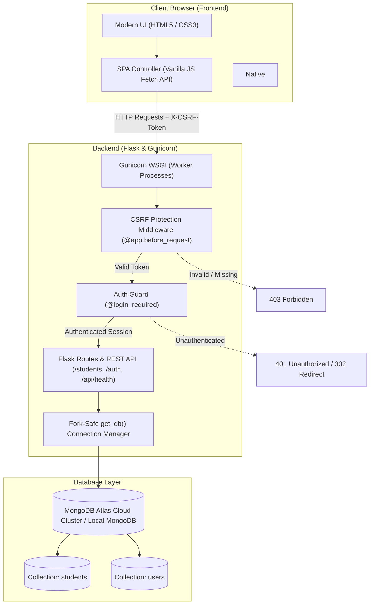

# StudentHub — Student Management CRUD Application

[](https://www.python.org/)
[](https://flask.palletsprojects.com/)
[](https://www.mongodb.com/atlas)
[](https://render.com/)
[](https://opensource.org/licenses/MIT)

A full-stack, production-ready **Student Management CRUD Application** built with **Python**, **Flask**, **MongoDB (PyMongo)**, and modern **Vanilla HTML5, CSS3, and JavaScript**.

This project provides an intuitive, high-performance web dashboard to manage student academic records with real-time database persistence, cryptographic user authentication, synchronized CSRF defense, client-side live search and multi-criteria filtering, and fork-safe connection management for both local development and cloud deployment on Render and MongoDB Atlas.

---

## 🔗 Project Links

* **Live Web Application (Render):** [https://student-crud-app-hquc.onrender.com/](https://student-crud-app-hquc.onrender.com/)
* **GitHub Source Code Repository:** [https://github.com/VishwasPoojary/student-crud-app](https://github.com/VishwasPoojary/student-crud-app)

---

## 📋 Table of Contents

1. [Project Overview](#-project-overview)
2. [Key Features](#-key-features)
3. [CRUD Operations](#-crud-operations)
4. [System Architecture & Request Flow](#-system-architecture--request-flow)
5. [Technology Stack](#-technology-stack)
6. [Project Folder Structure](#-project-folder-structure)
7. [Prerequisites](#-prerequisites)
8. [Local Installation & Setup](#-local-installation--setup)
9. [MongoDB Atlas & Environment Configuration](#-mongodb-atlas--environment-configuration)
10. [Running the Application Locally](#-running-the-application-locally)
11. [Production Deployment on Render](#-production-deployment-on-render)
12. [REST API & Authentication Routes](#-rest-api--authentication-routes)
13. [Database Schema Design](#-database-schema-design)
14. [Security & Validation Implementations](#-security--validation-implementations)
15. [Automated Testing & Verification](#-automated-testing--verification)
16. [Common Errors & Troubleshooting](#-common-errors--troubleshooting)
17. [Future Enhancements](#-future-enhancements)
18. [Author & Academic Profile](#-author--academic-profile)

---

## 📖 Project Overview

Managing student academic records efficiently requires a reliable backend, secure access control, and an intuitive user interface. **StudentHub** was engineered to solve this by providing an enterprise-grade yet lightweight CRUD (Create, Read, Update, Delete) management system.

Unlike introductory sample projects that rely on ephemeral browser storage (`localStorage`), static mock arrays, or unauthenticated forms, this application features:
* **Persistent NoSQL Database**: Real MongoDB database backing both locally and in the cloud with Atlas.
* **Full Session Authentication**: Protected endpoints, secure registration, password hashing, and user tracking.
* **Production Hardening**: Fork-safe MongoDB connection pooling under Gunicorn WSGI workers, masking of connection credentials in server logs, and synchronized token CSRF verification.
* **Single-Page Application (SPA) Experience**: Smooth asynchronous Fetch API requests with zero full-page browser refreshes during CRUD actions.

---

## 🌟 Key Features

### 1. Robust Security & Authentication
* **User Registration & Validation**: New users can register with Name, Email, Password (8–128 characters), and Password Confirmation. Email uniqueness is enforced via MongoDB unique indexing.
* **Cryptographic Password Hashing**: Passwords are salted and hashed using Werkzeug's secure implementation of `scrypt` / `PBKDF2`. Plaintext passwords are never stored or logged.
* **Session Fixation & Account Enumeration Defense**: Sessions are completely regenerated upon sign-in (`session.clear()`), and generic error messages (`Invalid email or password`) prevent credential fishing.
* **Synchronized Token CSRF Protection**: Every state-changing browser request (`POST`, `PUT`, `DELETE`) is guarded by a cryptographic token generated via Python's `secrets` module and verified with timing-attack-safe comparison (`secrets.compare_digest`).
* **Route & Endpoint Protection**: All dashboard views and student REST API endpoints are guarded by the `@login_required` decorator. Unauthenticated API calls receive strict `401 Unauthorized` responses.

### 2. Comprehensive Student Management (CRUD)
* **Add Student**: Create student profiles with Name, Email, Course, and Academic Year (Years 1–8). Automatically associates records with the logged-in administrator (`created_by`).
* **View Students**: Displays records in a clean, responsive table with initials-based color badges.
* **Edit Student**: Inline modal editing allows instant updates to existing student details.
* **Delete Student**: Secure confirmation dialog prevents accidental record removal.

### 3. Mutually Exclusive UI States
The dashboard UI dynamically transitions between mutually exclusive interface states to ensure a seamless user experience:
* **Loading State**: An animated CSS spinner and message while fetching data from MongoDB.
* **Empty State**: Clear visual illustration and an "Add Your First Student" prompt when no records exist or when search filters yield zero matches.
* **Populated State**: A polished, structured data table displayed strictly when student records are available.

### 4. Real-Time Client-Side Tools
* **Live Search**: Instant multi-attribute search across Name, Email, and Course fields with an instant clear button.
* **Multi-Filter**: Filter students by specific course or academic year.
* **Dynamic Statistics**: Header counter cards display real-time counts for Total Students, Total Courses Offered, and the active MongoDB collection name.
* **Toast Notifications**: Contextual toast banners (Success, Error, Info) provide immediate user feedback for all background operations.

### 5. Production Resilience
* **PID-Aware Lazy Database Connection**: Custom `get_db()` connection manager detects process forks under Gunicorn, closing inherited parent sockets and reopening worker-specific connections to avoid PyMongo fork warnings and Atlas SSL errors.
* **Public Health Check**: Dedicated `GET /api/health` diagnostic endpoint safely tests database connectivity (`ping` command and document count) without altering data.

---

## 🔄 CRUD Operations

| Operation | HTTP Method | Route | Description | Backend Logic |
| :--- | :--- | :--- | :--- | :--- |
| **Create** | `POST` | `/students` | Add a new student record | Validates fields, checks year range (1–8), attaches `created_by` and UTC timestamp, and inserts into MongoDB collection. |
| **Read** | `GET` | `/students` | Retrieve all student records | Queries `students` collection, maps MongoDB `_id` to `id` string, and returns a JSON list. |
| **Update** | `PUT` | `/students/<id>` | Modify an existing student | Validates MongoDB `ObjectId`, sanitizes input fields, and updates document via `$set` with `updated_at` timestamp. |
| **Delete** | `DELETE` | `/students/<id>` | Remove a student record | Validates MongoDB `ObjectId`, removes document via `delete_one`, and returns confirmation. |

---

## 🏗️ System Architecture & Request Flow

The following architecture diagram illustrates how incoming browser requests flow through the application stack, security layers, and database:



---

## 💻 Technology Stack

| Layer | Component | Version / Technology | Purpose |
| :--- | :--- | :--- | :--- |
| **Backend Framework** | Flask | `3.1.3` | Lightweight Python WSGI web framework and RESTful API router |
| **Language Runtime** | Python | `3.12+` | Core programming language |
| **WSGI Server** | Gunicorn | `26.2.0` | Production HTTP server for UNIX environments (Render) |
| **Database** | MongoDB Atlas / Local | `7.0+` | Scalable NoSQL document store (`student_management` database) |
| **Database Driver** | PyMongo | `4.18.2` | Official Python driver with connection pooling |
| **DNS Resolution** | dnspython | `2.8.0` | SRV record resolution for `mongodb+srv://` Atlas URIs |
| **Security & Hashing** | Werkzeug | `3.1.8` | Cryptographic password hashing (`scrypt` / `PBKDF2`) |
| **Configuration** | python-dotenv | `1.0.1` | Local `.env` environment variable management |
| **Frontend Layout** | HTML5 | Semantic Standard | Clean DOM structure, native `<dialog>` modals, and accessibility |
| **Frontend Styling** | CSS3 | Custom Properties | Responsive layout (Flexbox/Grid), dark/light accents, Inter typography |
| **Frontend Logic** | JavaScript | ES6+ Vanilla | Asynchronous Fetch API, DOM manipulation, and state switches |
| **Testing** | unittest | Standard Library | Automated regression and security test suite (19 test cases) |
| **Cloud Hosting** | Render | Web Service | Continuous deployment, automated builds, and SSL termination |

---

## 📁 Project Folder Structure

The project follows a clean, modular structure separating backend routing, templates, static frontend assets, and automated tests:

```text
student-crud-app/
├── app.py                  # Main Flask application: DB manager, auth routes, and REST API
├── requirements.txt        # Pinned Python package dependencies for local & production
├── .env.example            # Template configuration for environment variables
├── .gitignore              # Files excluded from git tracking (venv, .env, __pycache__)
├── README.md               # Comprehensive project documentation
├── templates/              # Server-rendered Jinja2 HTML templates
│   ├── index.html          # Protected single-page dashboard (table, stats, modals)
│   ├── login.html          # Secure login portal with password visibility toggle
│   └── register.html       # User registration interface with client/server validation
├── static/                 # Client-side static assets
│   ├── style.css           # Complete design system, animations, responsive layout
│   └── script.js           # Client-side SPA controller, Fetch API, and UI state switches
└── tests/                  # Automated testing suite
    └── test_auth.py        # 19 comprehensive unit & integration test cases
```

---

## ⚙️ Prerequisites

Before installing and running the application locally, ensure your development machine meets the following requirements:

1. **Python**: Version `3.10` or higher (Python `3.12` recommended).
   ```bash
   python3 --version
   ```
2. **Git**: Installed and configured.
   ```bash
   git --version
   ```
3. **Database** (Choose one):
   * **Local MongoDB**: Community Server running on `localhost:27017`.
   * **Cloud MongoDB**: Free MongoDB Atlas account with an active M0 cluster.

---

## 🛠️ Local Installation & Setup

Follow these step-by-step instructions to get a local development instance running:

### Step 1: Clone the Repository
```bash
git clone https://github.com/VishwasPoojary/student-crud-app.git
cd student-crud-app
```

### Step 2: Create and Activate a Python Virtual Environment
Creating an isolated virtual environment keeps dependencies separate from your global Python packages:

```bash
# On Linux / macOS:
python3 -m venv venv
source venv/bin/activate

# On Windows (Command Prompt):
python -m venv venv
venv\Scripts\activate.bat

# On Windows (PowerShell):
python -m venv venv
venv\Scripts\Activate.ps1
```

### Step 3: Install Required Dependencies
```bash
pip install --upgrade pip
pip install -r requirements.txt
```

---

## 🌐 MongoDB Atlas & Environment Configuration

The application automatically reads configuration from environment variables. A template file [`.env.example`](file:///.env.example) is provided.

### Step 1: Copy Environment Template
```bash
cp .env.example .env
```

### Step 2: Configure MongoDB Atlas (Production or Cloud Database)
If you want to use MongoDB Atlas instead of a local MongoDB server:

1. Log in to [MongoDB Atlas](https://www.mongodb.com/cloud/atlas).
2. Create a free **M0 Sandbox Cluster**.
3. Under **Security -> Database Access**, create a database user:
   * **Authentication Method**: Password
   * **Built-in Role**: `Read and write to any database`
4. Under **Security -> Network Access**, click **Add IP Address**:
   * Select **Allow Access from Anywhere** (`0.0.0.0/0`) so that both your local environment and Render cloud instances can connect.
5. Under **Database -> Clusters**, click **Connect** -> **Drivers** -> Select **Python** -> Copy the connection string.
   * Example: `mongodb+srv://<username>:<password>@cluster0.xxxxx.mongodb.net/student_management?retryWrites=true&w=majority`

### Step 3: Populate `.env` Variables
Open your `.env` file and configure the settings:

```ini
# Flask Secret Key (Generate with: python -c "import secrets; print(secrets.token_hex(32))")
SECRET_KEY=your-secure-random-secret-key-min-32-chars

# Environment Mode (development or production)
FLASK_ENV=development

# MongoDB Connection String:
# For Local MongoDB:
MONGODB_URI=mongodb://localhost:27017/
# For MongoDB Atlas (replace <username> and <password>):
# MONGODB_URI=mongodb+srv://<username>:<password>@cluster0.xxxxx.mongodb.net/student_management?retryWrites=true&w=majority

# Cookie Security (false for local HTTP, true for production HTTPS)
SESSION_COOKIE_SECURE=false

# Port (defaults to 5000)
PORT=5000
```

> [!WARNING]
> Never commit your real `.env` file to GitHub or any public version control system. It is included in `.gitignore` by default.

---

## 🚀 Running the Application Locally

### 1. Verify Local MongoDB Service (If using local MongoDB)
```bash
# On Linux (systemd):
sudo systemctl status mongod
# If stopped, start with:
sudo systemctl start mongod

# On macOS (Homebrew):
brew services list
# If stopped, start with:
brew services start mongodb-community
```

### 2. Start the Flask Development Server
With your virtual environment active, run:

```bash
python app.py
```

### 3. Access the Application
1. Open your web browser and navigate to:
   ```text
   http://127.0.0.1:5000/
   ```
2. Unauthenticated visitors are automatically redirected to `http://127.0.0.1:5000/login`.
3. Click **"Create an account"** (or go to `/register`) to register your first administrator account.
4. Sign in with your registered credentials to access the full student management dashboard.

---

## ☁️ Production Deployment on Render

The live version of this project is hosted on **Render** as a Python Web Service at:  
👉 **`https://student-crud-app-hquc.onrender.com/`**

### Step-by-Step Render Deployment Guide

1. **Push your code to GitHub**:
   Ensure your latest code is committed and pushed to your GitHub repository:
   ```bash
   git push origin main
   ```

2. **Create a New Web Service on Render**:
   * Navigate to the [Render Dashboard](https://dashboard.render.com/).
   * Click **New +** -> **Web Service**.
   * Connect your GitHub repository (`VishwasPoojary/student-crud-app`).

3. **Configure Service Settings**:
   * **Name**: `student-crud-app`
   * **Language / Runtime**: `Python 3`
   * **Region**: Choose the closest region to your users (e.g., Singapore, Oregon, Frankfurt).
   * **Branch**: `main`
   * **Build Command**: `pip install -r requirements.txt`
   * **Start Command**: `gunicorn app:app`

4. **Configure Environment Variables** (In the Render Dashboard under **Environment**):
   Add the following environment variables:

   | Key | Value / Recommendation |
   | :--- | :--- |
   | `SECRET_KEY` | High-entropy production key (e.g. 64-character hex string) |
   | `MONGODB_URI` | `mongodb+srv://<username>:<password>@cluster0.xxxxx.mongodb.net/student_management?retryWrites=true&w=majority` |
   | `SESSION_COOKIE_SECURE` | `true` (enforces HTTPS-only transmission of session cookies) |
   | `PYTHON_VERSION` | `3.12.3` |

5. **Deploy**:
   * Click **Create Web Service**.
   * Render will automatically install dependencies from `requirements.txt`, launch Gunicorn with worker processes, and bind to the dynamic port.
   * Access your live URL once the deployment logs show `Application startup complete`.

---

## 📡 REST API & Authentication Routes

### 1. Authentication & System Endpoints

| Method | Endpoint | Access | Request Body / Params | Description | Response Code |
| :--- | :--- | :--- | :--- | :--- | :--- |
| `GET` | `/` | Protected (`@login_required`) | None | Renders the student dashboard SPA. | `200 OK` / `302 Redirect` |
| `GET` | `/api/health` | Public | None | Diagnostic database connectivity test (`ping` + record count). | `200 OK` / `503 Service Unavailable` |
| `GET` | `/register` | Public | None | Serves the user registration interface. | `200 OK` |
| `POST` | `/register` | Public (CSRF guarded) | `name`, `email`, `password`, `confirm_password`, `csrf_token` | Validates credentials, creates user with hashed password. | `302 Redirect` / `400 Bad Request` |
| `GET` | `/login` | Public | Optional query param `?next=/` | Serves the user sign-in interface. | `200 OK` |
| `POST` | `/login` | Public (CSRF guarded) | `email`, `password`, `csrf_token` | Authenticates user, regenerates session, redirects. | `302 Redirect` / `401 Unauthorized` |
| `GET` / `POST` | `/logout` | Public | None | Clears user session cookie, redirects to login. | `302 Redirect` |

### 2. Student CRUD Endpoints (Protected by `@login_required` & CSRF)

| Method | Endpoint | Required Headers | Request Body | Description | Status Code |
| :--- | :--- | :--- | :--- | :--- | :--- |
| `GET` | `/students` | Session Cookie | None | Retrieves all student records from MongoDB. | `200 OK` / `401 Unauthorized` |
| `POST` | `/students` | Session Cookie, `X-CSRF-Token` | JSON: `name`, `email`, `course`, `year` | Adds a new student record to MongoDB. | `201 Created` / `400` / `401` / `403` |
| `PUT` | `/students/<id>` | Session Cookie, `X-CSRF-Token` | JSON: `name`, `email`, `course`, `year` | Updates an existing student record by ID. | `200 OK` / `400` / `401` / `403` / `404` |
| `DELETE` | `/students/<id>` | Session Cookie, `X-CSRF-Token` | None | Permanently deletes a student record by ID. | `200 OK` / `400` / `401` / `403` / `404` |

#### Sample Request & Response for `POST /students`:

**Request:**
```http
POST /students HTTP/1.1
Host: 127.0.0.1:5000
Content-Type: application/json
X-CSRF-Token: d8f4c7a2b910...
Cookie: session=ey...

{
  "name": "Ananya Rao",
  "email": "ananya.rao@example.com",
  "course": "Computer Science",
  "year": 3
}
```

**Response (`201 Created`):**
```json
{
  "id": "6732958ba1204d49a401c8de",
  "message": "Student added successfully",
  "student": {
    "course": "Computer Science",
    "email": "ananya.rao@example.com",
    "id": "6732958ba1204d49a401c8de",
    "name": "Ananya Rao",
    "year": 3
  }
}
```

---

## 🗄️ Database Schema Design

The application uses MongoDB database **`student_management`** with two primary collections: **`students`** and **`users`**.

### 1. `users` Collection Schema
Stores administrator accounts with cryptographic password hashes.

```json
{
  "_id": ObjectId("670f1a9b2c45e81d9f82a1b0"),
  "name": "Vishwas Poojary",
  "email": "vishwaspoojary140@gmail.com",
  "password_hash": "scrypt:32768:8:1$e4...$1a2b3c...",
  "created_at": ISODate("2026-10-10T06:30:00.000Z")
}
```

* **Indexes**: Unique index on `email` (`db.users.create_index("email", unique=True)`), preventing duplicate account registrations at the database engine level.
* **Security**: Passwords are never stored as plain text.

### 2. `students` Collection Schema
Stores student academic profiles.

```json
{
  "_id": ObjectId("670f1b2c2c45e81d9f82a1b1"),
  "name": "Vishwas J",
  "email": "vishwas@gmail.com",
  "course": "Computer Science",
  "year": 3,
  "created_by": "670f1a9b2c45e81d9f82a1b0",
  "created_by_name": "Vishwas Poojary",
  "created_at": ISODate("2026-10-10T06:35:12.000Z"),
  "updated_by": "670f1a9b2c45e81d9f82a1b0",
  "updated_at": ISODate("2026-10-10T07:15:00.000Z")
}
```

* **Fields**:
  * `name` *(string)*: Full student name (minimum 2 characters).
  * `email` *(string)*: Unique student contact email with format verification.
  * `course` *(string)*: Academic program (e.g., Computer Science, BCA, Data Science).
  * `year` *(integer)*: Current year of study (bounded between 1 and 8).
  * `created_by` / `created_by_name` *(string)*: Audit trail linking the student to the administrator who registered the entry.
  * `created_at` / `updated_at` *(ISODate)*: Accurate UTC timestamps for auditing.

---

## 🔒 Security & Validation Implementations

Security was built into the core architecture of the application rather than added as an afterthought:

1. **Scrypt Password Hashing**: Passwords are processed using `werkzeug.security.generate_password_hash` with `scrypt`, providing high resistance against GPU and ASIC brute-force attacks.
2. **Password Length Bounds**: Enforces a minimum of 8 characters and a maximum of 128 characters, protecting against denial-of-service (DoS) attacks caused by hashing overly long strings.
3. **Synchronized Token CSRF Defense**:
   * Generates a 256-bit cryptographically secure random token (`secrets.token_hex(32)`).
   * Embedded into templates via `<meta name="csrf-token" content="...">` and form hidden inputs.
   * Evaluated on all state-altering requests using constant-time string comparison (`secrets.compare_digest`).
4. **Session Cookie Hardening**:
   * `SESSION_COOKIE_HTTPONLY = True`: Blocks JavaScript access to session cookies, mitigating cross-site scripting (XSS) session theft.
   * `SESSION_COOKIE_SAMESITE = 'Lax'`: Protects cookies against cross-site request forgery.
   * `SESSION_COOKIE_SECURE = True`: Automatically enabled in production (`RENDER=true`) to enforce SSL/TLS transmission.
   * `PERMANENT_SESSION_LIFETIME = 24 Hours`.
5. **Anti-Session Fixation**: Calls `session.clear()` immediately before writing authenticated user data to reset the session token.
6. **Open Redirect Defense**: Sanitizes the `next` query parameter during login to prevent malicious redirects to external domains.
7. **Anti-Account Enumeration**: Returns generic `Invalid email or password` errors regardless of whether the user exists or the password is incorrect.
8. **Credential Masking in Logs**: Custom `sanitize_mongodb_uri()` function strips usernames and passwords from MongoDB connection strings in all application logs.
9. **Fork-Safe MongoClient (`get_db`)**: Lazy, process-aware database initialization ensures Gunicorn worker forks cleanly reconnect to MongoDB, preventing corrupted socket sharing and connection hangs.

---

## 🧪 Automated Testing & Verification

The project includes an automated test suite located at [`tests/test_auth.py`](file:///tests/test_auth.py) covering authentication, security enforcement, validation, and CRUD operations.

### Running the Test Suite
Ensure your virtual environment is active and local MongoDB is running, then execute:

```bash
python -m unittest -v tests/test_auth.py
```

### Automated Test Coverage Breakdown (19 Tests)

```text
test_01_unauthenticated_dashboard_redirects_to_login  ... ok
test_02_unauthenticated_api_get_students_returns_401  ... ok
test_03_unauthenticated_api_post_students_returns_401 ... ok
test_04_unauthenticated_api_put_students_returns_401  ... ok
test_05_unauthenticated_api_delete_students_returns_401 ... ok
test_06_register_missing_fields_rejected             ... ok
test_07_register_short_password_rejected             ... ok
test_08_register_password_mismatch_rejected          ... ok
test_09_register_valid_user_success                  ... ok
test_10_register_duplicate_email_rejected            ... ok
test_11_login_invalid_password_returns_generic_error  ... ok
test_12_login_nonexistent_email_returns_generic_error ... ok
test_13_login_valid_credentials_success              ... ok
test_14_authenticated_user_accesses_dashboard       ... ok
test_15_logout_clears_session_and_blocks_further_access ... ok
test_16_existing_student_records_intact              ... ok
test_17_authenticated_crud_lifecycle                ... ok
test_18_csrf_missing_token_rejected_with_403        ... ok
test_19_health_check_connectivity                   ... ok

----------------------------------------------------------------------
Ran 19 tests in 0.526s

OK
```

---

## ❓ Common Errors & Troubleshooting

### 1. `PyMongo Warning: MongoClient opened before fork`
* **Cause**: PyMongo's `MongoClient` was initialized at module import time in the parent process before Gunicorn spawned worker subprocesses, causing child processes to share the parent's socket pools.
* **Resolution**: The application implements the `get_db()` pattern. It verifies the current process ID (`os.getpid()`) against `_client_pid`, closing any inherited parent sockets and cleanly re-establishing a dedicated connection for each worker.

### 2. `ServerSelectionTimeoutError: SSL handshake failed` or `Connection Refused` on Render
* **Cause**: MongoDB Atlas Network Access is blocking the incoming connection from Render's cloud servers.
* **Resolution**: In MongoDB Atlas -> **Network Access**, ensure that `0.0.0.0/0` (Allow access from anywhere) is present in the IP Access List. Render uses dynamic IP addresses that change across instances.

### 3. `RuntimeError: CRITICAL: SECRET_KEY environment variable is required in production`
* **Cause**: The application detected a production environment (such as Render) but found no `SECRET_KEY` set.
* **Resolution**: Generate a 32-byte hex secret key using `python -c "import secrets; print(secrets.token_hex(32))"` and set it in your Render Web Service Environment settings.

### 4. `403 Forbidden: CSRF validation failed`
* **Cause**: A state-changing request (`POST`, `PUT`, `DELETE`) was submitted without the `X-CSRF-Token` header or with an expired session token.
* **Resolution**: Refresh the dashboard to receive an updated session token. The frontend automatically includes this header in all Fetch requests.

### 5. Local MongoDB Connection Refused (`localhost:27017`)
* **Cause**: The MongoDB service is not running on your local machine.
* **Resolution**: Start the MongoDB service using `sudo systemctl start mongod` (Linux) or `brew services start mongodb-community` (macOS).

---

## 🚀 Future Enhancements

The following improvements are planned for future versions of the platform:

* **Role-Based Access Control (RBAC)**: Distinct permissions for `SuperAdmin`, `Teacher` (CRUD), and `Viewer` (Read-only).
* **Pagination & Server-Side Search**: Cursor-based pagination to efficiently handle datasets exceeding 10,000+ student records.
* **Profile Image Uploads**: Student profile photo uploads stored securely via AWS S3 or Cloudinary with automated thumbnail generation.
* **Data Export**: One-click export of student directories to CSV, Excel (`.xlsx`), and formatted PDF reports.
* **Password Reset Workflow**: Secure password reset functionality via timed, signed tokens sent through SendGrid or AWS SES.

---

## 👨‍💻 Author & Academic Profile

* **Developer**: **Vishwas Poojary**
* **Academic Program**: Bachelor of Computer Applications (**BCA**)
* **Project Role**: Full-Stack Developer & Database Architect
* **GitHub**: [@VishwasPoojary](https://github.com/VishwasPoojary)
* **Project Repository**: [https://github.com/VishwasPoojary/student-crud-app](https://github.com/VishwasPoojary/student-crud-app)
* **Live Deployment**: [https://student-crud-app-hquc.onrender.com/](https://student-crud-app-hquc.onrender.com/)

---

## 📄 License

This project is licensed under the [MIT License](LICENSE) — free to use for academic, learning, and portfolio demonstration purposes.
